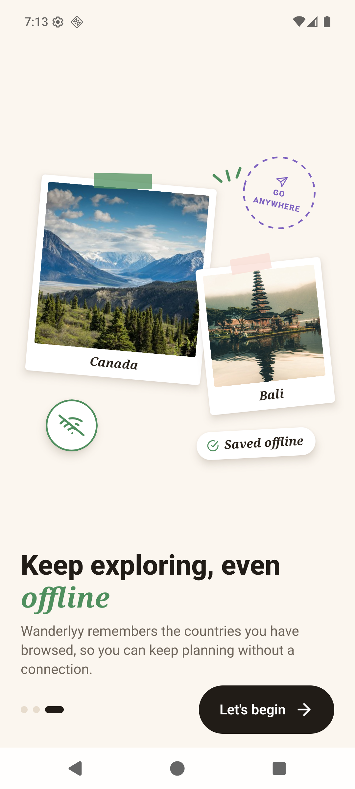
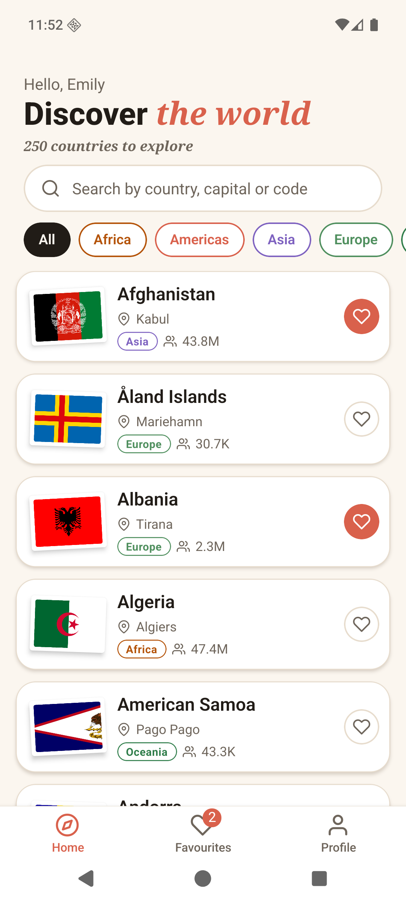
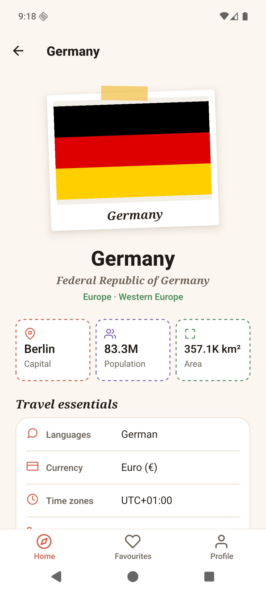
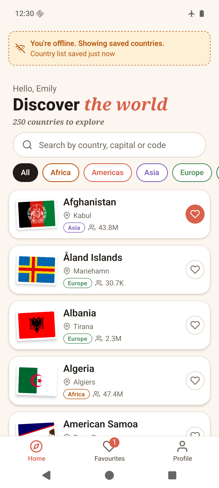
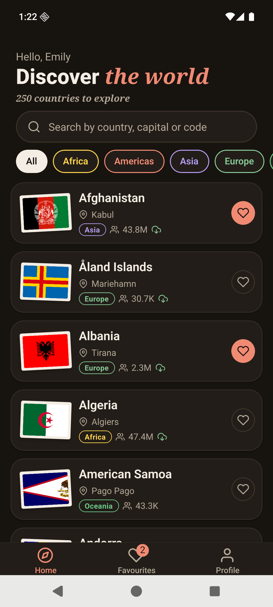
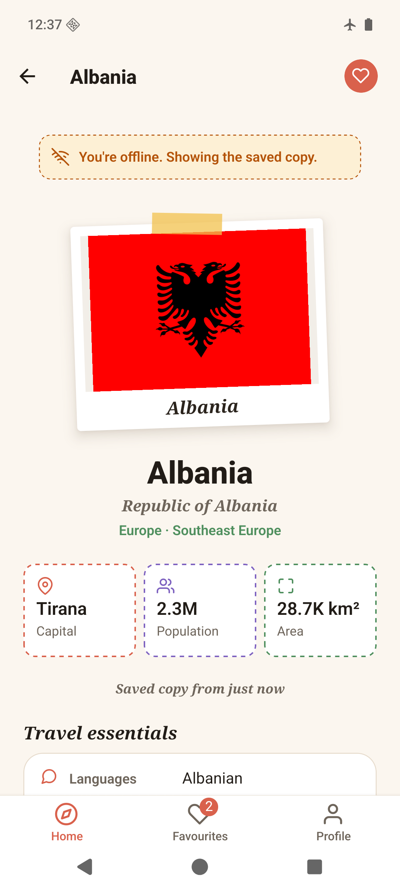
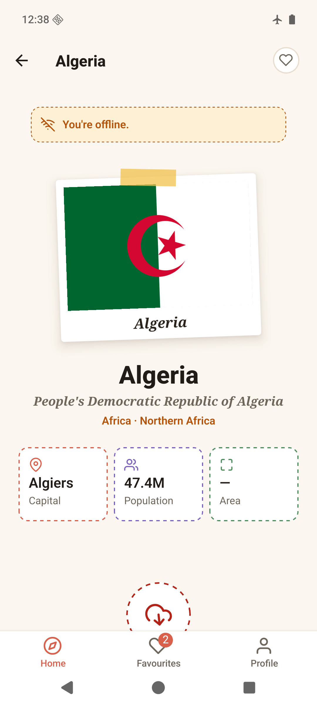
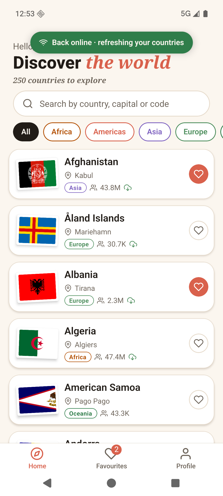

# Wanderlyy

**Discover every country in the world, even offline.**

Wanderlyy is a React Native (TypeScript) travel discovery app built for
**IN3210 – Mobile Applications, Assignment 2**.

| Index   | Domain (last digit 8) | Twist (second-last digit 5) |
| ------- | --------------------- | --------------------------- |
| 234058V | Travel & Countries    | **Offline-first**           |

You sign in, browse all 250 countries as scrapbook-style cards, search and
filter them, open a detailed travel page for any country, and save favourites
to a wishlist. Everything you have seen keeps working without a connection,
and the app refreshes stale data by itself when you are back online.

<p>
  
  
  
  
  
</p>

More screenshots are in [`docs/screenshots`](docs/screenshots).

---

## Contents

1. [Run it](#run-it)
2. [Features](#features)
3. [Assignment requirements](#assignment-requirements)
4. [Offline-first design](#offline-first-design)
5. [Architecture](#architecture)
6. [Key decisions](#key-decisions)
7. [Testing and quality](#testing-and-quality)
8. [Known limitations](#known-limitations)
9. [Credits](#credits)

---

## Run it

### Requirements

- Node.js 22.11 or newer
- JDK 17 and the Android SDK ([React Native environment setup](https://reactnative.dev/docs/set-up-your-environment), "React Native CLI", Android)
- An Android emulator or device (developed and tested on Android only)

### 1. Install

```bash
git clone https://github.com/supuni423/Wanderlyy.git
cd Wanderlyy
npm install
```

### 2. Add a REST Countries API key (required)

REST Countries shut down its free, keyless v3.1 API, so v5 needs a key. The
free plan (1,000 requests a month, no card) is plenty for this app.

1. Sign up at <https://restcountries.com/sign-up> and copy your API key
   (it starts with `rc_live_`).
2. Copy the template and paste the key after the `=`:

   ```bash
   cp .env.example .env
   ```

   ```
   RESTCOUNTRIES_API_KEY=rc_live_your_key_here
   ```

`.env` is git-ignored, so the key never reaches GitHub. Without a key the app
still runs and explains on the Home screen that the key is missing.

### 3. Start

```bash
npx react-native start --reset-cache   # Metro (use --reset-cache after editing .env)
npx react-native run-android           # in a second terminal
```

### 4. Sign in

Use the DummyJSON demo account (or tap **Use it** on the login screen):

| Username | Password     |
| -------- | ------------ |
| `emilys` | `emilyspass` |

### Useful scripts

| Command                              | What it does                                              |
| ------------------------------------ | --------------------------------------------------------- |
| `npm run verify`                     | ESLint + TypeScript + all tests (run before every commit) |
| `npm test`                           | Jest tests                                                |
| `npm run test:coverage`              | Tests with a coverage report and minimum thresholds       |
| `npm run lint` / `npm run typecheck` | ESLint / `tsc --noEmit`                                   |

---

## Features

**Sign-in**

- Splash screen and a 3-slide onboarding (shown once)
- Login and registration forms with Zod validation and clear error messages
- DummyJSON authentication; the session survives restarts and is restored
  (and refreshed if expired) at start-up
- Tokens are stored only in the encrypted Keychain

**Discover**

- Home: 250 countries as cards (flag, name, capital, region, population)
- Debounced search across name, official name, capital and ISO code,
  ignoring case and accents ("aland" finds "Åland")
- Region filter chips, plus a "Saved" chip for countries stored offline
- Loading, error (with **Try again**), empty and "no matches" states;
  pull to refresh

**Country details**

- Opens from just the country code and loads the rest itself
- Large flag, capital, population, area, languages, currency, time zones,
  calling code, driving side, demonym, coastline, web domain, flag story
- Neighbouring countries as chips: tap to hop across borders

**Favourites**

- Heart on every card and in the details header; badge on the tab
- Wishlist tab, newest first, with **Undo** after removing
- Saved favourites also download their full page for offline use

**Offline-first** (see [the design](#offline-first-design))

**Profile**

- Account, travel stats, appearance (System / Light / Dark), offline storage
  summary, clear favourites / offline data, replay intro, log out

**Bonus: dark mode**, following the phone or chosen in the app, and saved.

---

## Assignment requirements

| Requirement                                                                                     | Where                                                                                   |
| ----------------------------------------------------------------------------------------------- | --------------------------------------------------------------------------------------- |
| DummyJSON auth with Zod validation                                                              | `src/features/auth` (`validation.ts`, `authApi.ts`)                                     |
| Token in Keychain, never AsyncStorage/MMKV                                                      | `src/features/auth/sessionStorage.ts`; tests scan the store and AsyncStorage for tokens |
| React Navigation: auth flow, bottom tabs (Home, Favourites), Home → Details stack, typed params | `src/navigation` (`types.ts` holds every param list)                                    |
| Home cards with loading / error (retry) / empty states                                          | `src/features/countries/screens/HomeScreen.tsx`                                         |
| Details screen takes an ID only                                                                 | `CountryDetails: { code: string }`, loaded by `getCountryByCode`                        |
| Redux Toolkit + RTK Query                                                                       | `src/app/store.ts`, `authApi.ts`, `countriesApi.ts`                                     |
| Favourites persisted across restarts                                                            | `favouritesSlice.ts` + redux-persist (`src/app/persistence.ts`)                         |
| Theme tokens, Feather icons only, touch targets ≥ 48 dp                                         | `src/theme`, `@react-native-vector-icons/feather`, `TOUCH_TARGET = 48` (tested)         |
| TypeScript, feature folders, ESLint 0 errors, ≥ 3 Jest tests                                    | 259 tests; `npm run verify` is clean                                                    |
| README with Key decisions, AI_USAGE.md                                                          | This file, [`AI_USAGE.md`](AI_USAGE.md)                                                 |
| Demo video (≤ 3 min)                                                                            | Script: [`docs/DEMO_SCRIPT.md`](docs/DEMO_SCRIPT.md)                                    |
| Twist: offline-first                                                                            | [Offline-first design](#offline-first-design)                                           |
| Bonus: dark mode                                                                                | `src/features/settings`                                                                 |

---

## Offline-first design

The goal: **everything you have seen works without a connection, the app never
makes a request that cannot succeed, it explains instead of failing, and it
catches up by itself.**

| Situation                            | What happens                                                                                                   |
| ------------------------------------ | -------------------------------------------------------------------------------------------------------------- |
| Data arrives from the API            | Copied into a persisted offline cache (country list + every opened country page, capped at 100 pages)          |
| Opening Home or a country offline    | Shows the saved copy with "saved 3 h ago"; no request is attempted                                             |
| A country page that was never opened | Name, capital and population still show (from the saved list); the facts area says "Not saved for offline yet" |
| Saving a favourite online            | Its full page downloads straight away, so the wishlist works offline                                           |
| Saving a favourite offline           | Its page downloads on the next reconnect                                                                       |
| Signing in offline                   | Login explains that it needs the internet                                                                      |
| Restarting the app offline           | Still signed in (session in the Keychain) and the profile still shows                                          |
| Connection returns                   | "Back online" toast; data older than 30 minutes refreshes, fresh data is left alone                            |

Visual cues: an amber offline banner on every screen, a green ☁️↓ marker on
countries saved for offline, and a "Saved (n)" filter.

<p>
  
  
  
</p>

---

## Architecture

```
src/
├── app/            App root, EntryFlow (splash → intro → navigator), store, persistence
├── navigation/     Root / Auth / Main tabs, typed param lists, navigation theme
├── features/
│   ├── auth/       Login, Register, Zod rules, authApi, authSlice, Keychain session
│   ├── countries/  countriesApi (REST Countries v5), mapper, Home, Details, search
│   ├── favourites/ favouritesSlice, heart button, wishlist screen, Undo
│   ├── offline/    countriesCache, network monitor, banners, reconnect sync
│   ├── onboarding/ Splash, intro slides, "seen" flag
│   └── settings/   Profile, theme preference (dark mode)
├── components/     Shared UI: AppButton, AppInput, SearchBar, states, banners, scrapbook pieces
├── theme/          Design tokens (light + dark), ThemeProvider, shared styles
├── services/       Config (API key), API error messages
├── hooks/          useDebouncedValue
└── utils/          Formatting helpers
```

Each feature owns its screens, state, API calls and tests (`__tests__` next to
the code). Features talk through small public `index.ts` files.

**State**

| Slice                     | Persisted?  | Contents                                                                                        |
| ------------------------- | ----------- | ----------------------------------------------------------------------------------------------- |
| `auth`                    | `user` only | Status (`checking` / `authenticated` / `unauthenticated`) and the public profile. Never tokens. |
| `favourites`              | Yes         | Entity adapter of full country summaries + `savedAt`                                            |
| `countriesCache`          | Yes         | Offline copy of the list and opened pages                                                       |
| `theme`                   | Yes         | `system` / `light` / `dark`                                                                     |
| `network`                 | No          | `unknown` / `online` / `offline`                                                                |
| `authApi`, `countriesApi` | No          | RTK Query caches                                                                                |

**Where data lives**

| Data                                                    | Storage                                |
| ------------------------------------------------------- | -------------------------------------- |
| Access + refresh tokens                                 | Keychain / Android Keystore only       |
| Favourites, offline cache, theme, profile, "intro seen" | AsyncStorage (via redux-persist)       |
| REST Countries API key                                  | Git-ignored `.env`, read at build time |

**Tech stack:** React Native 0.88.1 (new architecture, Hermes) · React 19.3 ·
TypeScript 6 · Redux Toolkit 2.15 + RTK Query · redux-persist 6 · React
Navigation 7 · react-hook-form 7 + Zod 4 · react-native-keychain 11 ·
AsyncStorage 3 · NetInfo 12 · Feather icons · Jest 29 + React Native Testing
Library 14.

---

## Key decisions

1. **REST Countries v5 instead of v3.1.** The original plan used v3.1, but
   while building commit 12 every v1–v4 endpoint returned "This API version
   has been deprecated". v5 needs an API key, so the key lives in a
   git-ignored `.env` (read with react-native-dotenv) with `.env.example` for
   setup, and a test fails if a real key ever lands in `.env.example`.

2. **Tokens only in the Keychain, never in Redux.** `toUser()` copies just the
   profile fields from the login response. Session restore (`/auth/me`,
   `/auth/refresh`) uses plain `fetch` so refreshed tokens go straight to the
   Keychain. If the Keychain cannot save, sign-in is refused rather than
   falling back to a less safe place. Tests scan the whole store and all of
   AsyncStorage for tokens.

3. **Offline: stay signed in.** If the session cannot be checked because the
   phone is offline, the user stays signed in (only a rejected token signs
   them out). The saved profile keeps the app personal offline.

4. **Our own persisted cache next to RTK Query.** RTK Query's cache is memory
   only. A small `countriesCache` slice fills itself from RTK Query's
   `matchFulfilled` matchers and is persisted; screens render
   `liveData ?? savedCopy`. It is capped (100 pages), and a start-up
   migration drops damaged entries instead of crashing.

5. **Refresh only stale data on reconnect.** RTK Query's `refetchOnReconnect`
   was tried first, but measuring showed it re-downloads the whole list (3
   requests) on every reconnect, even when it is a minute old. With a
   1,000-request monthly quota, screens instead skip requests while offline
   and resume on reconnect with `refetchOnMountOrArgChange` = 30 minutes.
   Tests prove fresh data costs 0 extra requests and stale data refreshes.

6. **Never request what cannot succeed.** Queries are skipped while offline,
   so users see "Not saved for offline yet" instead of network errors, and
   pages load by themselves when the connection returns.

7. **Favourites store whole summaries, not just codes.** The wishlist shows
   flags and names offline without any lookup, and saving a favourite
   prefetches its page.

8. **Navigator chosen from auth state.** Only the auth stack or the main tabs
   exist at a time, so Back can never cross between signed-in and
   signed-out screens. Profile is a third tab (logout and settings live
   there); Home and Favourites are the required tabs.

9. **DummyJSON registration is simulated.** `POST /users/add` returns the new
   user but does not save it, so the app welcomes the user and explains to
   sign in with the demo account. The echoed password is dropped.

10. **`isInternetReachable: null` counts as online.** Android reports `null`
    until it has checked, so treating it as offline would flash a false
    "You're offline" at every start.

11. **Design.** A warm "travel scrapbook" look (cream paper, taped polaroids,
    italic serif highlights), inspired by a travel-journal onboarding concept
    found online. Only the style was reused; the photos are free Unsplash
    images bundled with the app so onboarding also works offline.

12. **Every commit passes `npm run verify`.** Commits run only after lint,
    typecheck and all tests pass.

---

## Testing and quality

- **259 tests in 31 suites**, all passing
- Coverage: **97.6 %** statements, **90.3 %** branches, **95.4 %**
  functions, **97.9 %** lines (thresholds enforced in `npm run test:coverage`)
- ESLint: 0 errors, 0 warnings. TypeScript: strict, no errors.
- Tests never touch the network or the real API key: `fetch` fails by default
  in every test and a fake key is injected; each test mocks exactly the
  responses it needs.
- Highlights: Zod rules, token safety (store + AsyncStorage scans), every
  session-restore path, persistence across simulated restarts, offline
  screens, reconnect request budget, 48 dp touch targets, dark mode.
- Real-data check: one mapper test uses a Japan record saved from the live
  REST Countries v5 API.

---

## Known limitations

- **Android only.** iOS was not built or tested (developed on Windows).
- **API key needed.** Evaluators need their own free REST Countries key
  (see [Run it](#run-it)).
- **Registered accounts cannot sign in.** DummyJSON does not store new users;
  use the demo account.
- **Flag images offline** appear only if Android's image cache already has
  them; the country data itself is always available.
- **System navigation bar in dark mode.** With "Dark" chosen while the phone
  is in light mode, Android's edge-to-edge navigation bar stays light.
  "System" (the default) always matches.

---

## Credits

- Country data: [REST Countries](https://restcountries.com) v5
- Sign-in: [DummyJSON](https://dummyjson.com)
- Icons: [Feather](https://feathericons.com) via `@react-native-vector-icons/feather`
- Onboarding photos: [Unsplash](https://unsplash.com) (see
  [`src/assets/images/onboarding/CREDITS.md`](src/assets/images/onboarding/CREDITS.md))
- AI assistance is declared in [`AI_USAGE.md`](AI_USAGE.md)
